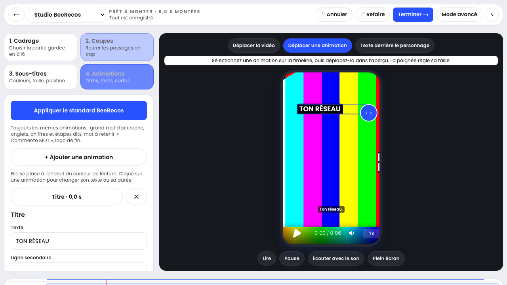

# Studio Reels — manipulation directe BeeRecos

Date : 6 novembre 2026. Dépôt : `Beerecos/InstagramBeerecos`, studio de BeeMarketing (`social.beemarketing.pro`). Base : `861d342`, branche de production `claude/motion-design-skills`.

## Comportement

- Les modèles et le standard BeeRecos existants sont conservés : bleu #2851FF, Poppins, titres, onglets, chiffres, logo officiel. Aucun montage utilisateur n'est réinitialisé.
- Les boutons au-dessus de l'aperçu permettent de déplacer la vidéo, déplacer une animation et ajouter du texte derrière le personnage, en mode simple comme avancé.
- Une carte de la timeline sélectionne l'animation à un instant où son entrée a commencé. Le déplacement et le redimensionnement sont visibles pendant le geste. Relâcher met à jour le brouillon ; « Enregistrer le montage » persiste les animations. Échap, pointercancel ou perte de capture annulent le geste.
- « Déplacer la vidéo » : glisser dans l'aperçu, régler le zoom ou recentrer. Le recadrage couvre d'abord la marge disponible de la prise, puis celle du zoom, sans exposer de bord vide. Une prise exactement 9:16 nécessite un zoom pour la déplacer. Sauvegarde par la file existante à la fin du geste ; les conflits serveur restent signalés.
- Le cadrage est identique sur la prise et sa silhouette, avec conservation du zoom alterné entre coupes. La composition exportée reçoit les mêmes valeurs que l'aperçu.
- Le moniteur conserve une hauteur suffisante sur ordinateur ; les petits écrans peuvent défiler jusqu'à la timeline. Le plein écran est aussi disponible en mode simple.

## Texte derrière le personnage : prérequis réel

Le bouton utilise `titre-derriere` et le détourage de la prise active. Si celui-ci manque, une fenêtre ouvre l'import du `.webm` transparent avec les explications. Si le détourage existe, le titre est ajouté sur la séquence et reste modifiable avant enregistrement. Les contrôles existants interdisent un titre derrière sans silhouette ou traversant plusieurs prises.

Le détourage automatique intégré n'est pas livré par ce changement. Le fichier transparent doit déjà avoir été préparé, avec durée et cadrage identiques. La commande existante de préparation est disponible dans une section technique repliée. Les tests de cette PR ne certifient pas la qualité du détourage d'un rush réel.

## Validation

- `npm test` : 651 tests unitaires + 11 tests historiques réussis.
- `npm run lint` : aucune erreur ; deux avertissements préexistants dans `feedback.ts` (`_op`, `_reason`).
- `npm run typecheck` : réussi ; TypeScript également vérifié par le build final.
- `npm run build` avec Turbopack : réussi (compilation utilisée en production).
- Playwright : `studio-direct`, `studio-instant`, `studio-timeline`, `motion-recovery` : 21 réussis, 5 ignorés explicitement sur mobile pour les gestes souris/clavier réservés au bureau.
- Vérification navigateur avec une vidéo de mire synthétique décodable : mise à jour du vrai lecteur Hyperframes pendant le glisser, aucune sauvegarde intermédiaire, annulation de cadrage, persistance cadrage + titre après rechargement, accès au détourage sur ordinateur/mobile, génération du titre derrière lorsque la silhouette existe, coupes et reprise d'anciens projets conservées.
- La capture ci-dessous a été ouverte et inspectée. L'API et les médias sont des fixtures de test. Aucune donnée client, aucun envoi social, aucun appel IA ou rendu vidéo payant. Pas de certification d'un MP4 final réel.

## Livraison et retour arrière

PR de préparation uniquement : pas de fusion ni de déploiement de production effectués pendant ce changement. Aucun schéma, secret, backend ou paramètre distant modifié. Après livraison, revenir au commit de base / annuler le commit de cette PR pour rétablir l'interface précédente. Les champs de placement, cadrage et détourage existaient déjà et restent lisibles par l'ancienne version.
